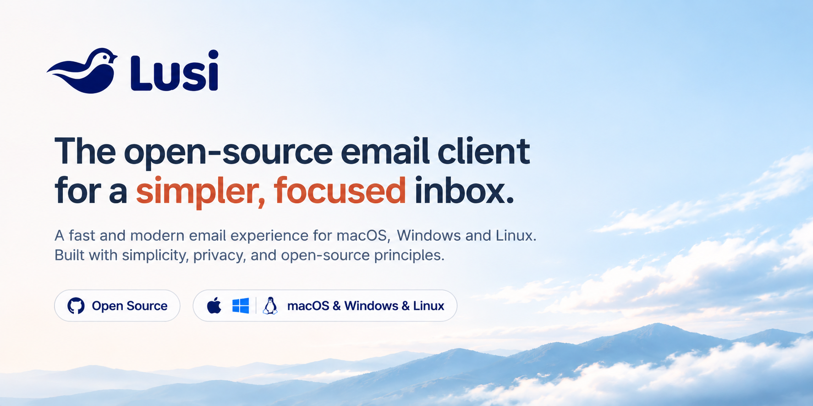

# Lusi — Let your messages flow.



Inspired by *Luscinia*, the nightingale, Lusi was born from a simple idea: communication should feel natural, effortless, and free.

Just as a little bird carries its song across the distance, Lusi helps your messages find their way.

No unnecessary noise. No complexity. Just your messages, beautifully presented.

Lusi is a lightweight, privacy-focused desktop mail client in development.

## Download the test build

Open [GitHub Releases](https://github.com/myenen/Lusi/releases) and choose the asset for your system.

| Platform | File | Setup |
| --- | --- | --- |
| macOS (Apple Silicon and Intel) | `.dmg` | Open the disk image and drag Lusi to Applications. |
| Windows (x64) | `-setup.exe` | Run the installer. It downloads WebView2 if the runtime is missing. |
| Linux (x86-64) | `.deb` or `.AppImage` | Use the package installer on Debian/Ubuntu, or mark the AppImage executable and open it. AppImage support depends on your distribution and its FUSE support. |

Preview installers ship with SHA-256 checksums. macOS builds are ad hoc signed without Apple notarization and Windows builds have no publisher signature, so either OS may show a trust warning or enforce its local policy.

## What works today

- When no account is connected, Lusi opens the account setup screen in light Liquid Glass.
- The main window opens maximized. Three resizable panes use theme-matched scrollbars, with a collapsible sidebar and a folder drawer on narrow windows.
- Search the current IMAP folder by sender name, email address, or subject, including messages that have not been loaded yet. Offline, search matches the headers already loaded. Results support sorting, the unread filter, and pagination.
- Read formatted HTML and plain-text messages. Remote HTTPS images load automatically in the HTML reader.
- See key points, requested actions, and explicit deadlines above the message. Summaries are extracted on-device from plain-text and HTML mail.
- Compose with rich-text controls or edit the HTML source. Outgoing messages include both HTML and a plain-text version.
- Mark messages as read when opened, or change their read and starred flags manually. Archive, trash, and restore messages on servers with the required folders and IMAP MOVE support.
- Send through SMTP with Cc, Bcc, and up to 5 MiB of attachments.
- Reply, reply all, and forward from the reader. Forwarding includes the original text.
- The desktop build remembers the theme and pane widths locally.
- Liquid Glass and Flat themes with different shapes, surfaces, density, and motion. Both support light and dark appearance.
- Open **Settings → Account Center** to add an email account or select a saved account. With multiple accounts, you can also switch using the account card at the bottom of the sidebar. Lusi reopens the last selected account. The sidebar provides quick access to system, light, and dark appearance.
- Turkish and English. The interface follows the system language by default, with English as the fallback.

### Connect a real mailbox

In the desktop build, start with your email address. Lusi checks the provider’s HTTPS Autoconfig file for incoming IMAP and outgoing SMTP. When both servers are found, enter the password or app password accepted by both. Lusi can also discover IMAP through the domain’s `_imaps._tcp` DNS SRV record. For any missing settings, enter the hostname, port, and TLS mode from your provider. Lusi uses the full email address by default and keeps any login discovered for the chosen server.

For `@gmail.com` and `@googlemail.com`, Lusi selects [Google’s IMAP and SMTP settings](https://developers.google.com/workspace/gmail/imap/imap-smtp) automatically. In a Gmail-enabled installer, select **Sign in with Google** and grant mail access in your browser. If access expires, use **Settings → Account Center → Reconnect with Google**.

For maintainers, configure a Lusi **Desktop app** OAuth client in [Google Cloud](https://developers.google.com/identity/protocols/oauth2/native-app). Set its ID in the GitHub Actions repository variable `LUSI_GOOGLE_CLIENT_ID` before building installers. If the desktop client requires the optional OAuth `client_secret` parameter, use the repository secret `LUSI_GOOGLE_DESKTOP_CLIENT_PARAMETER`. The desktop binary includes any configured parameter and is a public OAuth client. Use dedicated desktop client credentials and keep them out of Git. In Testing mode, add the invited accounts as Google test users. Public distribution with Gmail’s IMAP/SMTP scope requires the applicable [Google verification](https://developers.google.com/workspace/gmail/imap/xoauth2-protocol#oauth_20_scopes).

For local development, `LUSI_GOOGLE_CLIENT_ID` and the optional `LUSI_GOOGLE_CLIENT_SECRET` can still be supplied when building or launching Lusi.

Lusi encrypts the IMAP password in its local SQLite database and opens it automatically using a separate `credentials.key` file in the app data directory. During an upgrade, the first mailbox access may prompt for permission to read an existing password from the system credential store. A copy of both the key file and database can be used to recover the password. Keep the key private and retain it if you need to restore the encrypted account.

Each account has its own folders and cached Inbox. Lusi starts with up to 50 recent headers and loads older messages in batches as you scroll. Use **Load older messages** with the unread filter and **Load more results** during a search. Up to 50 recent Inbox headers per account are saved for offline listing. At startup, Lusi shows the active account’s saved Inbox and refreshes it in the background. A successful refresh reflects messages removed on the server, while a failed refresh keeps the saved list. A paperclip marks messages with attachments, and the reader lists available files. Select a supported file to open a temporary copy in the system’s default app. The download button keeps a copy in Downloads and opens supported file types when the transfer finishes. Both actions support files up to 50 MiB. The reader displays the first 1 MiB of the original message and reports when the preview is truncated. Lusi saves up to 256 opened message previews per account in the local database, so an already listed message can be reopened without fetching its body again. Attachment files still download on demand. Setup verifies SMTP authentication and Compose sends through the active account’s outgoing server. Lusi saves a copy of newly sent messages in the account’s IMAP Sent folder when the provider has not already saved it. Gmail saves its own copy. The desktop icon shows the active account’s unread Inbox total from the server. Windows taskbar overlays display 99+ for larger totals. While Lusi is running, it keeps the active account’s Inbox synchronized using IMAP IDLE or a two-minute polling interval. It updates the most recent 50 headers and downloads full headers only for newly encountered UIDs.

Lusi sends a desktop notification for new unread messages in the active account while the app is running. In **Settings → Notifications**, you can turn off alerts or choose to include the sender and subject. A burst is grouped into one alert that opens the newest message. On Windows, notifications from the installed app open the message from the banner or Notification Center.

Closing the window keeps Lusi in the macOS menu bar or the Windows system tray, where it continues checking mail. Click a notification to bring back the window and open the message. The tray also offers inbox, compose, settings, and manual sync shortcuts. Choose **Quit Lusi** to stop background sync. To make closing the window quit Lusi, turn off **Keep checking mail after closing the window** in **Settings → System Settings**.

Use **Select messages** next to Refresh to pick individual messages or select all visible results. The bulk toolbar can mark them as read or unread, archive them, or move them to Trash where the server supports it. In Trash, it can restore them to the Inbox. Changing the search or filter clears the selection.

Use **Print preview** in the message reader to review the message before opening the system print dialog. The print layout includes the message and attachment names. Remote images are omitted from the print layout.

## Preview in a browser first

Install Node.js 24 LTS, then run these commands from your terminal.

```sh
git clone https://github.com/myenen/Lusi.git
cd Lusi
npm ci
npm run dev -- --port 1421
```

Open [the local HTML preview](http://127.0.0.1:1421/). It shows the account setup interface. Mail and folder access require the desktop build.

## Run the desktop development build

Install stable Rust in addition to Node.js 24 LTS. Follow the [Tauri platform prerequisites](https://v2.tauri.app/start/prerequisites/) for Xcode or the Windows build tools and WebView2.

```sh
npm ci
npm run tauri -- dev
```

## Build an installer

On macOS, run `npm run tauri -- build --bundles dmg -- --locked`. On Windows, use `--bundles nsis`. On Linux, use `--bundles deb,appimage` after installing the [Tauri prerequisites](https://v2.tauri.app/start/prerequisites/). Tauri writes native builds to `src-tauri/target/release/bundle/`. A build with `--target universal-apple-darwin` writes to `src-tauri/target/universal-apple-darwin/release/bundle/` and requires both Rust macOS targets. [Desktop CI](https://github.com/myenen/Lusi/actions/workflows/ci.yml) builds and retains the installers for all three platforms.

See [CONTRIBUTING.md](CONTRIBUTING.md) for development checks, [the architecture overview](docs/architecture.md) for application boundaries, and [the design guidelines](docs/design-guidelines.md) for the interface direction.
