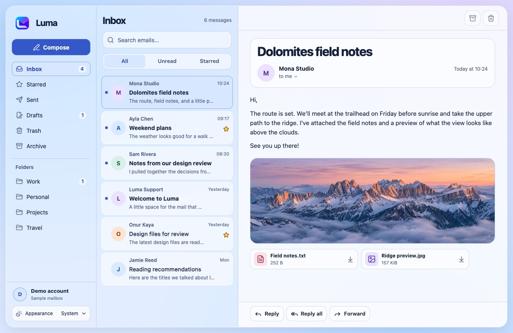

# Luma

Luma is a lightweight, privacy-focused desktop mail client in development for macOS and Windows. The current preview uses a sample mailbox you can explore without adding an account.



[View dark mode](docs/screenshots/luma-dark.jpg)

## What works today

- Three resizable panes, with a folder drawer and a list-to-reader view in narrow windows.
- Folder navigation, search, unread and starred filters, a plain-text reader, and sample attachments.
- Compose and reply previews, with system, light, and dark appearance options. The desktop build remembers the theme and pane widths locally.

Real account setup, sending, sync, and notifications are planned.

## Preview in a browser first

Install Node.js 24 LTS, then run these commands from your terminal.

```sh
git clone https://github.com/myenen/luma.git
cd luma
npm ci
npm run dev -- --port 1421
```

Open [the local HTML preview](http://127.0.0.1:1421/). It runs the interactive Luma interface with the sample mailbox. Desktop-specific behavior can be verified in Tauri after the interface review.

## Run the desktop development build

Install stable Rust in addition to Node.js 24 LTS. Follow the [Tauri platform prerequisites](https://v2.tauri.app/start/prerequisites/) for Xcode or the Windows build tools and WebView2.

```sh
npm ci
npm run tauri -- dev
```

## Build an installer

On macOS, run `npm run tauri -- build --bundles dmg -- --locked`. On Windows, run `npm run tauri -- build --bundles nsis -- --locked`. Tauri writes the development installers under `src-tauri/target/release/bundle/`. [Desktop CI](https://github.com/myenen/luma/actions/workflows/ci.yml) is configured to retain both installers as workflow artifacts.

To install the macOS preview, open the DMG and drag Luma to Applications. On Windows, open the installer and follow its prompts. There is no published release yet. Preview installers may trigger OS trust warnings.

See [CONTRIBUTING.md](CONTRIBUTING.md) for development checks, [the architecture overview](docs/architecture.md) for application boundaries, and [the design guidelines](docs/design-guidelines.md) for the interface direction.
